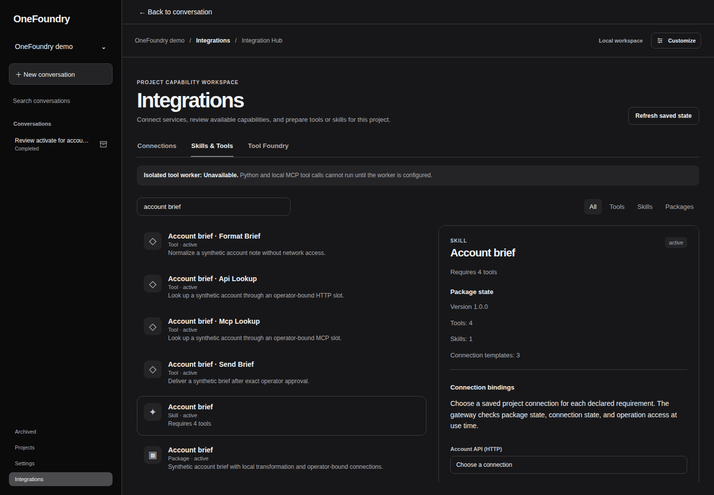
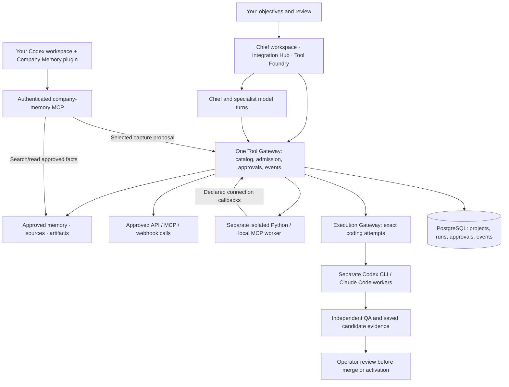

<div align="center">

# OneFoundry

**Your company. Your AI team. Your tools.**

A local AI team with cloud or locally hosted models, external coding clients, and company memory that carries forward.

[](LICENSE)
[](onefoundry/CHANGELOG.md)
[](https://github.com/kenjix217/OneFoundry/stargazers)

[Quick start](#quick-start) · [Cloud & local models](#cloud-apis-and-local-models) · [Coding clients](#coding-with-codex-and-claude-code) · [Company memory](#company-memory-across-coding-sessions) · [Python SDK](#build-your-first-extension) · [Architecture](#how-it-works) · [Contribute](CONTRIBUTING.md)

</div>

Give **Chief** an objective. Let **Researcher**, **Engineer**, **QA**, **GTM**, and **Sales** work from the same project context. Inspect their assignments, conversations, files, and results. Review useful knowledge into company memory so the next task starts with context.

**Keep your coding client and your company context together.** Delegate implementation to separate **Codex CLI** or **Claude Code** workers through the Execution Gateway. You can also work directly in Codex and connect the **OneFoundry Company Memory plugin** to retrieve approved knowledge and propose selected project knowledge for retention when you ask.

Make the team your own: choose models, instructions, tools, memory scope, and procedures per profile, or add a custom specialist. Extend its capabilities with Python tools, API connections, MCP servers, webhooks, and versioned `SKILL.md` procedures through one Tool Gateway.

OneFoundry is **MIT licensed**, built for a **single operator on localhost**, and developed in the open. Source, architecture, configuration examples, SDK, and tests live in this repository.

## Quick start

You need a trusted **Linux host**, **Git**, and **Docker Engine with Compose v2**. The first build downloads dependencies and container images.

```sh
git clone https://github.com/kenjix217/OneFoundry.git
cd OneFoundry/onefoundry
cp .env.example .env
chmod 600 .env
```

Edit `.env` and set **two different long passwords** for `DB_PASSWORD` and `APP_DB_PASSWORD`. Then:

```sh
docker compose up -d --build
curl -fsS http://127.0.0.1:8765/health/ready
```

Open **[localhost:8765](http://127.0.0.1:8765/)**:

1. **Create a project** and save its brief in **Settings → Project setup**.
2. Connect a supported model account in **Settings → AI connections**.
3. Choose models and review permissions in **Settings → Team**.
4. Give **Chief** an objective, or open **Integrations** to add a capability.

You can also choose **Continue without AI or a repository** and [record manual work](onefoundry/README.md#first-project-without-ai). Model usage may incur provider charges. Coding workers, mail, document accounts, and other optional services need their own configuration. See the [operator guide](onefoundry/README.md) and [environment example](onefoundry/.env.example).

## What you can build

| Capability | Put it to work |
| --- | --- |
| **A team for your company** | Chief coordinates specialist assignments and handoffs. Each profile has its own model, instructions, memory scope, tools, and autonomy setting. Talk to a specialist directly or follow its delegated conversation. |
| **Cloud APIs or local models** | Connect supported OpenAI, Anthropic, Gemini, xAI/Grok, and compatible cloud API providers, or host models locally with Ollama. Discover available models and choose an account/model per role. |
| **Company memory across coding sessions** | Connect Codex to the Company Memory plugin to retrieve approved facts and propose explicitly selected knowledge for review. Internal roles use the same project/company memory with source references. |
| **Tools that fit your work** | Package typed Python functions, declarative API operations, MCP capabilities, resources, and procedures with the Python SDK. Keep reusable package definitions separate from each project's credentials and configuration. |
| **Skills made by you or your agents** | Write procedures in Tool Foundry or let an admitted agent propose a draft. Review exact instructions and required tools before accepting an immutable version. Pin versions to profiles. |
| **Connected APIs and MCP servers** | Save shared project connections, bind declared package slots, and configure them from a plugin, tool, or skill. Readiness shows configuration, credentials, live checks, and successful use separately. |
| **Event-driven work** | Receive signed, deduplicated webhooks through the existing automation pipeline. Prepare work from mail, watched files, or rules. Outbound webhooks and generic API/MCP calls keep exact-call approval and saved outcomes. |
| **External coding agents and independent QA** | Delegate scoped Engineer/QA assignments and dispatch coding through separate Codex CLI or Claude Code workers. Keep exact attempts, diffs, tests, results, and approval records in OneFoundry. See the [supported coding paths](#coding-with-codex-and-claude-code). |
| **Research, drafts, and deliverables** | Work with input documents, approved memory, registered repositories, and granted public-web tools. Keep artifacts with their tasks. Optional document, mail, browser, and video workers add supported workflows. |

Try an objective such as **“Turn these product notes and customer findings into a launch brief and an outreach draft.”** Chief can assign Researcher, GTM, and Sales, retain their results, and bring the outward decision back to you.

## Cloud APIs and local models

Choose the model connection that fits each role:

| Connection | How it fits |
| --- | --- |
| **Cloud model APIs** | OpenAI, Anthropic, Google Gemini, xAI/Grok, and connectable OpenAI-compatible providers in the bundled directory. Credentials stay in protected local storage. |
| **Locally hosted models** | Use the optional Compose Ollama service, or a reachable loopback Ollama endpoint when running OneFoundry on the host. Install a model there, discover its catalog, and assign it to a role. |
| **A mixed team** | Bind each profile to its own configured account/model. For example, use a local model for one role and a supported cloud provider for another. |

Configure these under **Settings → AI connections**, then choose models in **Team**. Available models and tool support depend on the provider and selected runtime. A local OneFoundry installation can still make cloud requests when you choose cloud models or external services. See [model connection setup](onefoundry/README.md#model-account-configuration).

## Coding with Codex and Claude Code

OneFoundry coordinates the objective, Engineer and QA assignments, dependencies, approvals, and saved evidence. The **external coding client** performs file edits and commands and owns its coding loop. The Execution Gateway and separate runner connect those attempts back to the work order.

Chief can delegate scoped coding and review assignments. Provider-native coding subagents remain under the chosen client's controls and the runner's permissions; their deployment is not separately qualified in this release. The current isolated maintenance path uses Codex with independent QA and reviewed activation. The separate Codex/Claude trusted-host path has live evidence on a fixed disposable repository. These paths need their own configuration; they do not establish unrestricted coding or deployment for arbitrary repositories. Read the [coding setup](onefoundry/README.md#delegated-coding) and [maintenance runtime](onefoundry/docs/SELF_EXTENSION_RUNTIME.md).

## Company memory across coding sessions

Work directly in Codex and connect the **OneFoundry Company Memory plugin**, or use OneFoundry's internal roles against the same reviewed memory store. Retain architecture decisions, repository context, build/test procedures, and useful lessons with their sources so later sessions can retrieve them.

1. **Retrieve before coding.** Search and read approved facts relevant to the selected project.
2. **Ask to retain a decision.** Select the company-related excerpt and a factual summary, such as: “Propose saving this architecture decision and these build/test steps to this project's OneFoundry memory.”
3. **Confirm the selection.** With capture access enabled, Codex previews the exact excerpt, summary, source, scope, and retention notice. Your confirmation archives the selected excerpt and submits a pending proposal; the source stays archived even if the candidate is rejected.
4. **Review in OneFoundry.** Approve the candidate in **Memory → Browse & review**. Approved facts become available to later authorized sessions and role agents.

Use **project scope** for repository-specific knowledge and **company scope** for knowledge intentionally shared across projects. Capture is off by default, bounded, and explicitly requested; connecting the plugin does not automatically archive conversations or synchronize entire codebases. Search/read access alone cannot save or approve a fact. Plugin installation also needs a configured, authenticated memory service and grants. See the [plugin source](onefoundry/plugins/onefoundry-company-memory/README.md), [connection setup](onefoundry/docs/company-memory.md#private-companion-deployment), and [selective capture flow](onefoundry/docs/company-memory.md#selective-api-key-capture-optional).

## One place for integrations

**Integration Hub** and **Tool Foundry** are views over the existing Tool Gateway. They share its catalog, permissions, approval flow, and event records.

- **Connections** — configure project APIs/MCP endpoints and credentials, inspect readiness, and manage signed incoming webhooks.
- **Skills & Tools** — search tools, skills, and package versions; inspect prerequisites and bind saved project connections.
- **Tool Foundry** — create a skill proposal, import an inert ZIP, or start a Python/API/MCP/webhook package from a template. Review it before requesting activation.



*Actual application UI in the Black & Grey theme, using the synthetic account-brief SDK example. The preview shows an unconfigured worker; Python and local MCP execution require the separate supervisor.*

### Build your first extension

For SDK development, install **Python 3.12** and **uv 0.12.19**. From `onefoundry/`:

```sh
uv sync --locked
mkdir -p output
cp -R sdk/python/examples/account-brief output/account-brief
uv run --locked onefoundry-sdk validate output/account-brief
uv run --locked onefoundry-sdk test output/account-brief
uv run --locked onefoundry-sdk build output/account-brief --output output/account-brief.zip
uv run --locked onefoundry-sdk inspect output/account-brief.zip
```

This copies a complete example with an `extension.json`, Python source, a skill, and fixtures to edit. For an empty manifest, use `uv run --locked onefoundry-sdk init output/my-extension --id my-extension --name "My extension"`. `test` validates fixture structure and schemas; behavioral execution uses the configured isolated worker. These commands use the SDK from this checkout; they do not depend on a published PyPI release.

In **Integrations → Tool Foundry → Plugin package**, choose the ZIP and **Import inert draft**. Inspect its definitions, configure the shared project connections, and request activation of the exact package version. Review profile tool grants and skill pins separately in **Team**. A first-time connection template becomes available after its package draft is saved.

Start with the [SDK guide](onefoundry/sdk/python/README.md) or the [account-brief example](onefoundry/sdk/python/examples/account-brief/README.md), which combines a Python formatter, API/MCP lookups, a skill, and approval-bound webhook delivery.

**Bring existing procedures.** Native OneFoundry, Codex portable, Codex legacy, and Claude package adapters provide import/export and per-component compatibility reports. Supported skills, resources, provenance, and inactive remote MCP templates can travel. Foreign hooks, shell commands, agents, and permissions are rejected or remain inactive; import never executes them or transfers authority. See [format and runtime details](onefoundry/docs/UNIVERSAL_EXTENSION_RUNTIME.md#webhooks-and-portability).

## How it works



**One authority for tools.** The Tool Gateway checks project scope, the run's saved permissions, current profile grants, exact inputs, and required approvals. Integration Hub does not introduce another dispatcher. A `SKILL.md` supplies procedure and never grants tools or credentials.

**Separate execution boundaries.** The app never imports arbitrary plugin Python or launches a coding CLI. Extension children run without network or host mounts, with a read-only root and resource bounds. Their declared connection requests return to the Gateway. The trusted supervisor is configured separately from the web app.

**Durable results.** PostgreSQL stores workflow state and append-only activity; artifacts have saved hashes. Runs pin package, tool, connection, binding, and worker identities. An uncertain external outcome stays unknown for reconciliation instead of being automatically sent again.

**Local storage, explicit connections.** Project data, artifacts, and private credentials use local storage. Configured model providers receive admitted task context; enabled connectors communicate with their configured services. OneFoundry is a localhost application with no public login or remote multi-user boundary.

The stack is **Python / FastAPI / Pydantic**, **OpenAI Agents SDK** for native model/tool turns, **React / TypeScript**, **PostgreSQL / Alembic**, and **Docker Compose**, with a locked `uv` environment. Coding providers retain their own agent loops. Read the [architecture](onefoundry/docs/ARCHITECTURE.md), [extension design](onefoundry/docs/UNIVERSAL_EXTENSION_DESIGN.md), and [supervisor contract](onefoundry/docs/EXTENSION_SUPERVISOR.md).

## Project status

**Early preview — source version 0.20.0.** The extension implementation includes the SDK, UI, API/MCP transports, isolated worker, reviewed skill drafts, webhooks, and package adapters. Source availability, installation, a connected account, and a qualified end-to-end workflow are separate states.

Recorded acceptance includes 20 SDK tests, 864 main unit cases, 673 selected PostgreSQL cases, 460 frontend tests, real worker/Gateway integration checks, and desktop/mobile/native 200% zoom checks. **The complete `make check` command is not green:** an existing Codex broker fixture exceeded a Docker attach deadline. The focused unchanged case passes, but that does not close the full regression gate. The [implementation record](onefoundry/docs/UNIVERSAL_EXTENSION_IMPLEMENTATION.md) preserves the failure and remaining work.

The [installed maintenance acceptance](onefoundry/docs/SELF_EXTENSION_COMPLETION.md) applies to its recorded release and configuration. Arbitrary repository changes and unrestricted deployment are outside that qualified path. Some account integrations still need live provider acceptance. This source update does not install or activate the capability on an existing system.

Use the [release guide](onefoundry/docs/RELEASE.md) for source bundles, installation, checksums, backups, health checks, and rollback. A public binary download channel has not been published.

## Find your way around

| I want to… | Start here |
| --- | --- |
| Configure and use the team | [Operator guide](onefoundry/README.md) |
| Build a plugin, tool, or skill | [Python SDK](onefoundry/sdk/python/README.md) · [Reference package](onefoundry/sdk/python/examples/account-brief/README.md) |
| Connect APIs/MCP or receive webhooks | [Extension runtime and settings](onefoundry/docs/UNIVERSAL_EXTENSION_RUNTIME.md) |
| Run isolated Python or local MCP | [Extension supervisor](onefoundry/docs/EXTENSION_SUPERVISOR.md) |
| Understand ownership and permissions | [Architecture](onefoundry/docs/ARCHITECTURE.md) · [Extension design](onefoundry/docs/UNIVERSAL_EXTENSION_DESIGN.md) |
| Work with company memory | [Memory guide](onefoundry/docs/company-memory.md) |
| Configure delegated coding | [Coding setup](onefoundry/README.md#delegated-coding) · [Maintenance runtime](onefoundry/docs/SELF_EXTENSION_RUNTIME.md) |
| Develop or report a problem | [Contributing](CONTRIBUTING.md) · [Issues](https://github.com/kenjix217/OneFoundry/issues) |
| See changes and verification | [Changelog](onefoundry/CHANGELOG.md) · [Progress](onefoundry/PROGRESS.md) |

```text
onefoundry/
├── src/onefoundry/  # API, workflow owners, Tool Gateway, Execution Gateway
├── frontend/       # React workspace and integration authoring UI
├── sdk/python/     # Extension contracts, package tools, and examples
├── runner/         # Separate execution and verification workers
├── migrations/     # PostgreSQL schema history
└── docs/           # Architecture, configuration, operations, and evidence
```

## Build with us

Found a workflow that should be easier? [Open an issue](https://github.com/kenjix217/OneFoundry/issues), share a reproducible bug, improve a guide, or contribute a focused change. Useful first contributions include SDK examples, connector adapters, accessibility, onboarding, and regression tests. Read [CONTRIBUTING.md](CONTRIBUTING.md) for the development setup and review expectations.

If OneFoundry fits the way you want to work, **[give the project a star](https://github.com/kenjix217/OneFoundry)** to follow its progress. Help us make a company AI team easier to understand, extend, and operate.

README presentation draws on the onboarding and documentation structure of [OpenClaw](https://github.com/openclaw/openclaw/blob/main/README.md) and [Hermes Agent](https://github.com/NousResearch/hermes-agent/blob/main/README.md). The capability and architecture descriptions above refer to OneFoundry.

## License

OneFoundry is available under the **[MIT License](LICENSE)**. You can use, modify, and distribute it, including commercially, subject to the license notice. Third-party components retain their own licenses and notices. Package import/export preserves supplied provenance; it does not certify another package's license.
