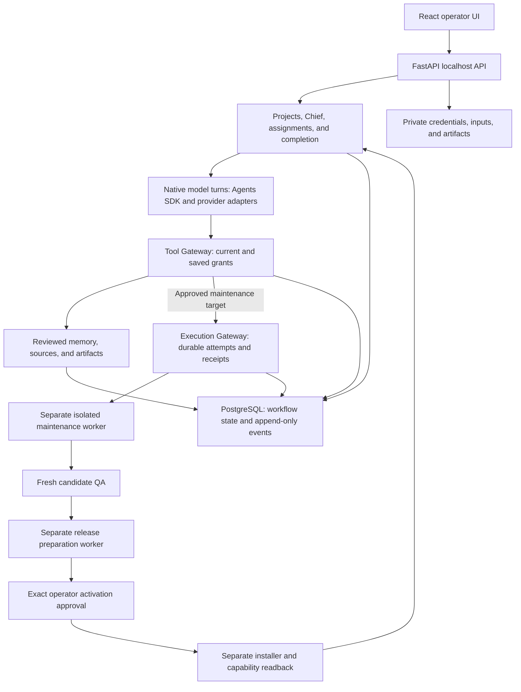

# OneFoundry architecture

OneFoundry is a single-operator localhost workspace for a coordinated AI team. It combines durable work orders, scoped model tools, reviewed company memory, and separate coding and release workers. This overview describes current source owners; [VERSION](../VERSION), [PROGRESS.md](../PROGRESS.md), and [installed acceptance](SELF_EXTENSION_COMPLETION.md) distinguish source changes from release qualification. Design notes and the frozen KJ31 archive are not runtime dependencies.

## Runtime and ownership

The diagram follows native team work and approved maintenance. Ordinary research and drafting do not need the coding or release path. The separate trusted-host fixture runner has a different contract, described below.

- **Interface and API.** React/TypeScript uses the local FastAPI API. Localhost Host and write-Origin checks protect the intended browser path. There is no user login or remote multi-user boundary; the deployment assumes a trusted single-user host. Project scope organizes work, while company memory is an explicit shared scope.
- **Workflow state.** Python domain owners manage projects, profiles, work orders, team sessions, assignments, attempts, results, approvals, and completion. The OpenAI Agents SDK owns native model/tool turns through the configured provider adapters. OneFoundry does not implement a coding-agent loop or launch coding CLIs in FastAPI.
- **Tool authority.** The Tool Gateway checks the saved run/profile snapshot and current grants, then applies project, input, approval, and capability rules. A model binding, profile name, procedure, or message cannot grant a tool.
- **Persistence.** PostgreSQL and Alembic own structured state, actor attribution, exact snapshots, approvals, receipt metadata, artifact paths, and SHA-256 hashes. Restricted database roles and triggers protect append-only events. Private persistent storage holds credentials, inputs, artifacts, and worker spools. File readback verifies the expected bytes and hash.
- **Companion processes.** Separate workers own bounded input extraction, coding, candidate QA, release preparation, installation, and optional browser/video work. A coordination service claims eligible intents through PostgreSQL; credentialed mailbox/document watchers remain with their owning app services. Each companion has explicit readiness and configuration requirements.

## From conversation to completion

Sending Chief an objective saves a root job and queues the configured team worker. Chief can delegate assignments with declared dependencies and supplied context. Direct-agent conversations use the selected profile's model, tools, and memory scope. Opening an empty conversation creates no model turn.

A reply, completed model turn, and completed work order are different facts. Supported internal team completion checks accepted assignment evidence, independent QA from another profile, and outstanding work or uncertainty. Coding and outbound assignments retain their own completion owners. Failed, blocked, and unknown outcomes remain distinct; unknown effects require reconciliation rather than automatic replay. Public progress and saved action details are available without exposing private model reasoning.

Current task state and long-lived knowledge are separate inputs. Team context preserves required objectives and reads the relevant saved owners; legacy Task chat uses its bounded job dossier. Provider context limits and configured execution/output bounds still apply even when native prompt budgets are configured as unlimited.

## Coding, QA, and activation

The Execution Gateway records exact coding attempts, frozen input identities, readiness, cancellation, and terminal receipts. It reconciles evidence from a separate worker instead of treating dispatch as success.

For native maintenance, Chief first checks the actual operation. Missing permission or configuration uses the setup owner. A verified implementation gap can create a linked Engineer assignment against an approved OneFoundry maintenance source. Target approval binds the original task, committed source revision, allowed edit paths, acceptance commands, QA image, configured model/provider, and execution bounds.

The isolated Codex worker receives a filtered committed tree and disposable home. Credentials, Git history/configuration, receipt storage, and the running checkout stay outside the coding container. A separate broker admits bounded provider access. Approved text changes become a saved candidate; baseline checks must fail and candidate checks must pass. Independent QA reconstructs that exact patch in a fresh tree and runs the approved commands without public networking.

A separate release worker prepares the versioned package. Activation approval binds candidate, QA, package hash, expected installed base, configuration/migration effects, grants, and recovery plan. The installer drains managed work, checkpoints persistent state, uses the supported updater, and reads back installed identity and capability. Failed readback invokes rollback; uncertain activation remains held for reconciliation. Verified activation can restore the original task checkpoint, whose deliverable still needs acceptance.

The recorded [native acceptance](SELF_EXTENSION_COMPLETION.md) covers this path using Codex subscription credentials. See [runtime and configuration](SELF_EXTENSION_RUNTIME.md) for the exact protocol and limits. An existing login is not sufficient evidence that the worker is configured or ready.

The older `external_code` trusted-host path uses Codex CLI or Claude Code on a fixed disposable calculator repository. Both adapters have live fixture evidence. This opt-in worker shares the operator's host account and is not the isolated native maintenance worker. It saves bounded sessions, progress, diffs, tests, artifacts, and receipts; it does not establish arbitrary-repository coding or independent QA for that host path. Scripted networkless fixtures and the offline local-source probe remain separate diagnostics. See [delegated coding](../README.md#delegated-coding).

## Memory, procedures, and external assistants

PostgreSQL's approved memory store is authoritative for internal agents and authorized external clients. Project and company scope are explicit. Captured conversations remain separate source archives, and capture is off by default. An operator reviews a candidate before publication; pending or rejected material stays out of retrieval. Corrections and withdrawal preserve history.

Local lexical retrieval is the default. Optional local hybrid retrieval adds current-model embeddings and matching by meaning. Approved or restored facts and their required embeddings publish atomically; an embedding failure leaves publication incomplete instead of presenting an unsearchable fact as ready.

The company-memory MCP service uses authenticated, server-owned grants for search/read and optional explicitly selected capture proposals. It does not expose SQL, arbitrary tools, or approval authority. The separate [Zoho Mail connector](zoho-mail.md) has its own project-bound client and approval rules; provider sign-in and mailbox acceptance remain separate gates. Neither integration implies a generic plugin catalog or installation flow.

The Skill Library stores immutable `SKILL.md` versions. Profiles can pin procedures and supported turns can select bounded relevant procedures. Saved versions and hashes make the supplied instructions inspectable. Procedure content never grants tools or overrides approval. See [company memory](company-memory.md) for review, capture, scope, MCP, and embedding configuration.

## Connections, automation, and outward actions

Profiles resolve their configured model account and route for each native turn. Provider adapters determine supported model and tool behavior. API keys and account tokens live in protected local credential storage outside PostgreSQL, events, artifacts, and release bundles. The app's model connection and an external coding CLI's login are separate stores. Admitted company context can go to the configured AI provider; enabled research and connector actions use their configured services.

Project automation can react to admitted signals and schedules, create work, and optionally start eligible text work within configured bounds. `COORDINATION_MODE` defaults to `off`; connections and rules require operator setup. Mail intake, watched documents, paired remote messaging, and approved file writes retain their own scope and uncertainty rules. A remote message cannot grant tools or approve an outward action.

Outgoing SMTP uses a separately configured account. Exact plain-text proposals bind sender/version, recipient, subject, body hash, run, and one approval. A claim precedes one network attempt. SMTP acceptance means server acceptance, not recipient delivery; ambiguous outcomes remain unknown without automatic retry. Other outward actions need both exact approval and their implemented executor. An approval record alone cannot publish, merge, deploy, or change a cloud service.

## Source, release, and local data

The source stack uses Python/FastAPI/Pydantic with strict typing, `uv` and a lockfile, React/TypeScript, PostgreSQL/Alembic, and Docker Compose. The release builder exports one committed revision and packages prebuilt image bytes, Compose files, a manifest, version, and the operator CLI. Private environment settings, credentials, databases, input files, and generated artifacts are excluded.

An installation uses versioned release directories and a `current` selection; declared persistent volumes survive software updates. The updater requires an operator-supplied archive and trusted external SHA-256, checks images, stops the exact Compose project, checkpoints persistent state, applies migrations, and checks readiness. Failed activation attempts recovery. Data-restoring rollback requires explicit confirmation because it discards writes after the checkpoint. `doctor` checks installed identity, services, volumes, configuration, and readiness.

A source change, package build, installation, healthy runtime, and accepted workflow are separate claims. Source-preview success does not certify another installed release. Read the [release guide](RELEASE.md) for supported operations and the [publication safeguards](GIT_HYGIENE.md) for keeping private state out of Git. No public download channel or multi-host deployment is qualified here.
