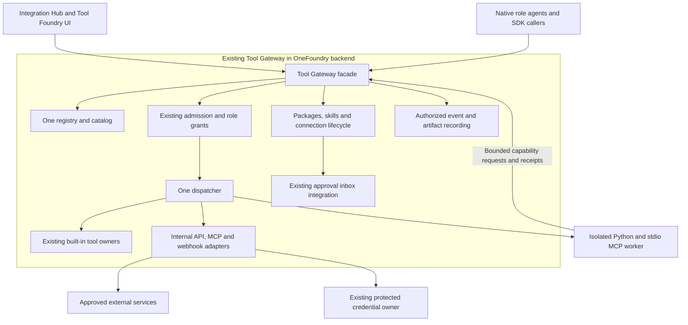

# OneFoundry Tool Gateway expansion and Python SDK design

Status: design complete; all source implementation slices are available in 0.20.0. Complete regression acceptance remains blocked by the recorded Docker runtime failure. Revised: October 16, 2026. Active checklist: [implementation plan](UNIVERSAL_EXTENSION_IMPLEMENTATION.md).

Expand OneFoundry's existing **Tool Gateway** to support plugins, tools, MCP, API connections, webhooks, and skill authoring. Integration Hub and Tool Foundry are names for UI views over that same gateway. They introduce no separate backend service, independent registry, permission authority, dispatcher, or approval system. Provide a small Python authoring SDK that describes packages and calls the gateway's existing authority through its supported contracts.

The operator owns JintellarCore and explicitly authorizes copying its code, SDK, and UI. Copy and adapt useful components directly where they fit OneFoundry. Preserve upstream notices for any separately licensed dependencies or vendored components. JintellarCore's service topology is a reference; OneFoundry keeps its consolidated Tool Gateway ownership.

The operator should be able to connect an MCP server or API while editing a plugin, tool, or skill. Each entry point opens the same connection editor and saves a reference to the same project-owned connection. A skill can require and explain a capability; activation and Tool Gateway admission determine whether an agent can use it.

## Findings from the existing systems

JintellarCore references name paths in the separately owned reference repository. It is not a runtime dependency; OneFoundry source links below resolve within this repository.

| System | Observed in source | Consequence for OneFoundry |
| --- | --- | --- |
| JintellarCore Integration Hub | External API/MCP connections, credentials, connector packages, and a unified catalog are distinct from generated internal tools. `JintellarCore: docs/INTEGRATION_HUB_ARCHITECTURE.md:34` | Adapt connection and tool definitions as cohesive modules inside the existing Tool Gateway, sharing its registry and discovery contract. |
| JintellarCore Tool Foundry | A workbench shows creation/review timelines, Internal Tools, and Skill MD. `JintellarCore: dashboard/src/features/tool-foundry/ToolFoundryWorkbench.tsx:70` | Borrow creation, testing, and review flow. Use readable draft titles and automatic linked evidence rather than asking staff for session IDs. |
| JintellarCore Python SDK | Validation covers manifests, schemas, adapters, auth references, dependencies, and secret-like values. Runtime BaseSkill uses Integration Hub subprocess/socket contracts. `JintellarCore: sdk/python/jintellarcore_tool_sdk/validator.py:150`, `JintellarCore: sdk/python/jintellarcore_sdk.py:69` | Copy and adapt compatible validators, schemas, and SDK components. Replace Nervous, tenant, and socket coupling with OneFoundry Tool Gateway and worker contracts. |
| JintellarCore instructions | Skill Markdown is bounded, non-executable instruction content. The MCP setup screen is currently GitHub-specific. `JintellarCore: core/integration_hub/skill_instructions.py:12`, `JintellarCore: dashboard/src/features/skills/MCPSkillsScreen.tsx:53` | Retain instruction-only skills and design a general connection editor. A universal MCP editor cannot simply copy that screen. |
| OneFoundry tools | Canonical tools are code-registered. Admission binds the active project/run/profile and intersects saved and current grants. [Admission](../src/onefoundry/role_tool_admission.py#L384) | Extend this authority with approved package descriptors. A second plugin dispatcher must not bypass admission. |
| OneFoundry skills | Immutable, hashed SKILL.md versions, profile pins, and run snapshots already exist. [Store](../src/onefoundry/skill_store.py#L128), [editor](../frontend/src/SkillLibrary.tsx#L87) | Add structured prerequisites and draft review around this owner; preserve existing version IDs and pins. |
| OneFoundry SDK and plugins | live_tool_sdk adapts admitted tools to the model SDK. Company-memory and Zoho MCP integrations are specific integrations. [Bridge](../src/onefoundry/live_tool_sdk.py#L183), [architecture](ARCHITECTURE.md) | A public extension authoring SDK and generic connection runtime are new work. Existing integrations are compatibility examples, not proof that arbitrary packages already work. |
| OneFoundry activation | Self-extension already binds proposals, independent QA, release identity, human approval, installed readback, and grants. [Architecture](ARCHITECTURE.md), [grant owner](../src/onefoundry/extension_tool_grants.py#L24) | Reuse approval, evidence, and attribution contracts. Package installation needs its own exact-version record; it must not pretend to be a shipped app release. |

This review establishes source contracts and package formats. It does not establish live JintellarCore connector success or live OneFoundry extension execution. Representative Codex and Claude plugins expose manifests and Markdown directly, so REA decompilation was unnecessary; no plugin payload was run. The REA skill was consulted for target routing.

Copying operator-owned JintellarCore code and assets is authorized. Selection is based on fit with OneFoundry's contracts and dependencies; no additional ownership confirmation is required for that code.

## Product model

| Object | Responsibility | Does not grant |
| --- | --- | --- |
| Plugin package | A versioned distribution containing tool definitions, connection templates (including outbound webhooks), skills, tests, and provenance; signed inbound subscriptions are configured separately through the Gateway | Runtime access, credentials, or role permissions |
| Connection | Project-owned endpoint, transport, approved operations, non-secret settings, and a credential reference | Access to every advertised server tool |
| Tool | One typed operation with input/output schemas, effect classification, execution binding, and declared connection requirements | Its own network, filesystem, database, or approval authority |
| Skill | Versioned instructions plus structured tool/connection prerequisites and usage guidance | Tools, credentials, autonomy, or approval |
| Role binding | Profile tool grants and skill version pins; shared project connection slots and exact package/connection identities are resolved and pinned for each run | Permission to bypass action-specific gates |
| Webhook | Authenticated event intake or an explicit outbound delivery operation | Authority to execute arbitrary instructions from the payload |

Packages may contain only skills, only declarative API tools, an MCP connection template, Python operations, or a combination. Python is the first authoring language; JSON Schema and MCP remain the interoperability boundary. Existing MCP servers in other languages can participate without being rewritten.

Package templates may be reusable, but installed instances, connections, bindings, and receipts remain project-owned with actor attribution. Company memory retains its existing explicit shared scope. A global connection that silently exposes one project's credentials to another is outside this proposal.

## Proposed page layout

Add **Integrations** alongside Chief and Settings in the existing shell. This is the user-facing workspace for the existing Tool Gateway. Keep the current project selector, appearance settings, and accessible navigation. Copy and adapt JintellarCore's compact workspace header, horizontal tabs, searchable catalog, and detail panel to OneFoundry's quieter typography and spacing.

The workspace has three tabs:

- **Connections:** MCP, API, accounts, and webhooks. Reuse current accounts/mail/folder owners through linked views before consolidating their forms. Connection details show configuration, credential presence and explicit probe results. Role access stays in Team; a shared Recent tool calls list shows saved invocation outcomes and links to Approvals.
- **Skills & Tools:** One catalog, filterable by Plugins, Tools, and Skills. Selecting a plugin shows its included capabilities; selecting a skill shows instructions, package availability and prerequisites. Profile usage and version pins remain with Procedures/Team. Existing Procedures links remain available.
- **Tool Foundry:** Create a plugin, Python tool, API tool, MCP connection, webhook, or skill. Start from a template, import a package, write it yourself, or ask an agent to prepare a draft. The v1 workbench has skill/package forms and a shared Configure panel; saved drafts and exact review actions appear in Skills & Tools. SDK fixtures and connection probes use their existing test owners, rather than a second test runner in the editor.

A reusable **Configure connection** panel appears from plugin, tool, and skill editors. The operator selects an existing connection or creates one; the tool package slot stores the typed project binding. Skills select canonical tools and open this same editor without owning another endpoint. Show endpoint/auth method and requested operations, with secret entry confined to the credential workflow. Do not duplicate a credential into a skill body or package.

The end-to-end workflow is **Describe → Draft → Configure → Test → Review → Enable**, composed across the Foundry, SDK, Connections, Team and Approvals owners. The v1 form presents **Describe → Configure → Review → Request enable**; it does not present an integrated test/profile-selection wizard. Use SDK structural fixtures, isolated behavioral fixtures or the Connections probe as appropriate, and configure profile grants/pins in Team. Keep one primary action per form. Put schemas, package hashes, transport details, and raw diagnostics under Details. A test result states whether it was fixture-only, a connection handshake, a live invocation, or acceptance of the final task.

On desktop, use a list/detail arrangement with independently scrolling navigation and content. On mobile, use a single list followed by a detail screen with Back; stack connection forms and retain visible action labels. Required acceptance viewports are 1440×900 and 390×844, plus keyboard navigation and 200% zoom.

The accompanying clickable preview uses synthetic examples. Its Configure and Test controls demonstrate presentation only and make no network calls or saved changes.

## One expanded Tool Gateway

The existing Tool Gateway is the single public backend facade for capability management and execution. It owns registration, discovery, connection bindings, package/skill draft lifecycle, admission, approval-bound activation, dispatch, and event recording, using the existing domain stores and approval inbox. The UI and SDK use that facade. Internal modules keep implementation responsibilities focused without creating parallel ownership.



The gateway's catalog describes capabilities; its admission module decides availability; its dispatcher selects the admitted built-in, adapter, or worker. API/MCP/webhook adapters perform admitted transport operations as internal gateway implementation, attaching credentials outside user code. There is no separately deployed connection broker. The isolated worker runs user code without database credentials, host secrets, app source mounts, receipt-store access, Docker socket access, or unrestricted networking.

Calls from Python back to a connection or another tool return to the same Tool Gateway and re-enter admission with the original project/run/profile and remaining budget; nested calls cannot expand grants or evade approval. Use an unforgeable gateway-issued invocation capability bound to project/run/profile, exact package and connection versions, allowed operations, remaining budget, and deadline. The gateway must never trust identity fields supplied by the worker. Bound call depth and reject cycles. Worker isolation is an execution boundary; the worker owns no capability registry, grants, or approval decisions.

Worker callbacks use private authenticated IPC tied to that invocation capability. No public HTTP route accepts a caller-claimed agent identity. Operator-facing local API requests keep the existing host/origin checks and operator attribution; webhook payloads remain untrusted intake rather than agent authorization.

Remote API/MCP calls must not reuse the current synchronous read-tool path while it holds a database context lock. The gateway validates and durably claims exact intent/approval in a short transaction, releases locks before network or worker dispatch, then records the result or unknown outcome in a separate transaction. Reconciliation remains gateway-owned and never automatically replays an uncertain effect.

Do not import user plugin modules, package build backends, or local MCP commands into FastAPI. Inspect manifests and declarative descriptors without importing Python. Build backends and dependency installation execute untrusted code, so builds require the same isolation standard as runtime tools. Fetch pinned dependencies only through restricted, approved package sources, with no app-secret or receipt-store mounts. Before execution, independently prove network/filesystem/process isolation; copying a Compose service name or reusing a trusted-host fixture runner is insufficient.

The existing **Execution Gateway remains the owner of coding-provider work**. Engineer uses Codex/Claude through that gateway to author packages. Running a plugin function is a separate bounded extension-worker job, not a new coding-agent loop. Share proven isolation primitives only where the contracts match.

Only the Tool Gateway and an authorized runner event writer append events. Transport adapters and SDK code return typed receipts to that owner; they receive no general event-writing database access. Store large outputs as hashed artifacts under the existing artifact owner.

### Suggested modules and persistence

Extend the `ToolGateway` facade and existing `role_tool_admission` contract. Keep `skill_store`, current credential owners, and existing approval stores as the persistence owners they already are. Implement package validation/versioning, catalog projection, connection bindings, transports, and worker protocol as focused gateway-owned modules called by that facade. The module names and layout are implementation details to settle in slice 1; retain existing imports and callers. Keep routes thin and avoid putting every transport into the already large `tool_gateway.py` file. Shared gateway ownership does not require one giant source file.

Proposed records: package/version, project installation, tool-version descriptor, connection/version, requirement binding, draft/review evidence, invocation receipt, webhook subscription/delivery. Reuse skill/version/profile binding, artifacts, work orders, approvals, and events. Final migration names and constraints belong in the first approved slice. Every record has project and operator/agent actor attribution, including triggers and receipts; secrets remain outside these records.

The current tool registry, model advertisement, dispatcher, and grant validator use code-registered IDs. Before any dynamic operation is enabled, add one authoritative resolver for built-in and approved package descriptors. Preserve built-in IDs; namespace package operations, reject collisions and ambiguous versions, and route advertisement, grant validation, and invocation through that same resolver. Test saved/current grant intersection, package revocation, schema drift, and installed-version readback across all four consumers.

Activation admits the exact package digest and revision through the existing approval inbox, using compare-and-swap to prevent stale decisions. It does not grant a role tools or prove a connection works. Profile grants, shared connection configuration/testing, worker readiness and exact effect approval retain their existing focused owners inside the same Tool Gateway. This separation makes each operator decision concrete without coupling a code package to mutable endpoint settings. Revocation prevents new invocations; an in-flight effect is cancelled where supported or reconciled explicitly.

Each run snapshots the package digest, tool descriptor/schema identity, connection identity/configuration/binding versions and pinned worker image where applicable. Invocation requires those exact identities and current grants. A package update or endpoint/binding change cannot silently replace a tool during that run; deny the stale call and require a newly reviewed run binding. Existing numeric tool versions and allowed-tool names alone are insufficient for dynamic packages.

## Python SDK contract

Use the distributable `onefoundry-sdk` authoring library, with strict Pydantic models and generated JSON Schema. It provides package declarations, validation, testing, and gateway connection callbacks; it has no independent runtime registry or permission engine. The audited version-one contract is below.

```text
customer-research/
  extension.json              # Identity, version, tools, connection slots, skills
  skills/account-brief/SKILL.md
  src/customer_research.py
  resources/company-fields.json
  tests/account-brief.json
  LICENSE
```

The manifest carries identity/version, schema version, tool/skill exports, effect declarations and connection operation schemas. LICENSE and NOTICE files retain provenance; inspection reports package and file digests. Runtime endpoints, secret values, role IDs and operator settings are resolved from the project installation. Import schemas are strict and versioned; unknown executable fields cannot silently disappear.

An illustrative Python tool:

```python
from onefoundry_sdk import ToolContext, tool


@tool("account_brief")
async def account_brief(ctx: ToolContext, company: str) -> dict[str, object]:
    result = await ctx.connections.invoke(
        slot="customer_records",
        operation="lookup_company",
        arguments={"company": company},
    )
    return dict(result)
```

The descriptor separately declares input/output JSON Schemas and `required_connections`. A Python tool using callbacks must declare `effect: pure`; each connected target must also be declared, separately granted and snapshot-pinned. `ctx.connections.invoke` sends a bounded request to the same Tool Gateway, which obtains exact-call approval before remote dispatch. The worker context contains gateway-issued project/run/profile/actor identities and the bounded connection facade. Cancellation and deadlines are enforced by the host protocol. Version one exchanges bounded JSON only and supplies no filesystem artifact handle, raw credential or database handle. Input and output validation run at the gateway boundary even if plugin code uses the decorator incorrectly.

Commands are `init`, `validate`, `test`, `build`, `inspect`, `import`, and `export`. SDK `test` validates fixture input/output schemas without running code and explicitly reports `execution: not_run`. The separate host `runner.extension_fixture_test` executes pure, connection-free fixtures in the pinned network-disabled worker. Connected behavior is tested through gateway admission and approvals. `build` creates an inert archive, and `export` produces a compatibility report. Installation and activation occur through OneFoundry's operator flow. Importing a skill-only package requires no Python execution.

Version one uses the dependencies locked into the pinned worker image; package archives cannot install dependencies or run setup hooks. Repository dependency changes require license compatibility review. Package inspection checks hashes, archive paths/symlinks, resource limits and known-secret patterns; imports and exports preserve supplied LICENSE/NOTICE provenance for operator review. It does not infer or certify a foreign package's license compatibility. Secret scanning is one check, not proof that a package contains no secret. Typed failures distinguish invalid input, permission denial, missing configuration, dependency failure, timeout, cancellation, and unknown effect.

## Connections and configuration within editors

Skills reference canonical tools and reuse the project connection selected by each tool package slot. The skill editor opens the same shared connection modal; it does not create a second endpoint or credential owner. Changing a shared binding invalidates existing run pins; a new run uses the current binding and every remote invocation still needs exact disclosure approval. Accepted instruction text does not grant access or independently freeze a private destination.

Use one typed connection specification with kind, approved destination, auth method, credential reference, configuration version, allowed operations, and protocol settings. Reuse current typed settings and credential storage; introduce configuration only when an existing owner does not cover it. Installation selects one validated project configuration; missing security settings fail closed. No silent machine defaults or scattered environment reads.

| Kind | Setup and operation contract |
| --- | --- |
| HTTP API | Guided connection form and strict package operation schemas. Review each operation's method, path, input/output mapping, destination, auth and effect. External schema references are rejected. GET is not proof of a harmless effect. |
| Remote MCP | Begin with Streamable HTTP. Operator-requested discovery returns bounded diagnostic server/tool metadata. Selected operations are declared in strict reviewed package descriptors; discovery never installs or grants them. Each call checks the live input schema against its descriptor and fails on drift. |
| Local MCP | Slice 4. A pinned server package runs in the isolated worker; no arbitrary shell command in the app. Host-local endpoints require an explicitly reviewed route and must not open unrestricted host networking. |
| Webhook intake | Verify provider signature over bounded raw bytes, delivery identity, timestamp, and replay rules; map to one project subscription and a supported automation signal. Network acknowledgement means durable receipt, not task completion. |
| Webhook delivery | An outbound HTTP write tool with connection kind `webhook`, an exact approved destination and payload identity. Record delivery attempts and ambiguous outcomes. Retry only where the destination's idempotency/reconciliation contract permits. |

MCP server metadata, descriptions, schemas, API responses, and webhook payloads are untrusted input. Bound their size and validate syntax. An MCP read-only annotation is advisory; an operator-reviewed descriptor owns effect policy. Sampling, elicitation, server-initiated actions, and executable hooks are unsupported until separately designed.

The v1 editor shows saved configuration/enabled status, credential presence and explicit probe outcome as separate facts. Role grants remain in Team and successful use appears in invocation receipts. It does not claim a persisted discovery approval or a six-stage readiness workflow. A saved key or successful probe cannot grant a tool. Skills show canonical prerequisites and open the shared Configure editor.

Never store credentials in SKILL.md, manifests, events, artifacts, model context, URLs, or frontend-persisted state. The gateway's internal transport adapter resolves authentication through the existing credential owner. Validate destination and OAuth metadata, redirects, DNS resolution, private/link-local networks, and audience/scope at every applicable boundary. Local services need explicit exceptions to destination policy, not a blanket localhost exemption. See the official [MCP security guidance](https://modelcontextprotocol.io/specification/latest/basic/security_best_practices).

Existing curated connectors keep their existing action policies. New generic API/MCP calls, including probes and reads, start without network authority; operator-requested tests must disclose the destination and transmitted test input. Enabling a connection or marking an operation read-only does not authorize unrestricted company-data egress. Email, publishing, merging, deploying, cloud operations, and other outbound actions retain action-specific approval. The configured AI-provider and Researcher search exceptions remain with their existing owners.

Slice 3 admits only reviewed lookup operations with explicit approval bound to the destination, operation/schema, connection version, and disclosed inputs. Tests use synthetic data. Record a durable invocation claim before network I/O and keep dependency failure separate from an ambiguous remote effect. Do not automatically replay an uncertain call. Generic write support waits for slice 5, whose executor must bind exact effect/payload identity, approval consumption, idempotency where supported, and reconciliation before launch. HTTP methods and MCP annotations cannot substitute for this classification.

## Operator and agent skill authoring

An operator writes a procedure and selects canonical tools in Foundry, binds required connections through the shared configuration owner, chooses profiles in Team, and reviews the exact immutable version. Package fixture plans run through the SDK and isolated host; connection handshakes run from Connections. The text-only skill form stores instructions and prerequisites, with examples/test procedures included in SKILL.md when needed; it does not store a separate executable test plan. Saving a draft is separate from making it eligible for automatic selection or changing profile pins. A version can be saved with unresolved prerequisites, but it stays visibly unavailable for execution through those prerequisites.

An agent can propose a new skill or revision using its existing work-order identity. It supplies purpose, SKILL.md, proposed tool/connection requirements, examples, and tests. A generated package needing code uses an Engineer assignment through the Execution Gateway and independent QA. A text-only skill proposal does not need to trigger a coding build.

The catalog review shows a text-only draft's SKILL.md and requested canonical tools with exact accept/reject actions. This direct operator gate does not create a separate approval-inbox row or claim an automatic diff/test-results display. Package activation/revocation and connected tool calls use Approvals; invocation proposals disclose their exact destinations and inputs there. Operator acceptance appends the exact approved skill version and prerequisite metadata. Project tool bindings and profile grants are configured through their existing owners. Pending/rejected skill text must be excluded from runtime automatic matching; a save must not accidentally make a draft the latest eligible skill. Existing pins and in-progress run snapshots remain exact.

Current `skill_store.add_version` immediately publishes a version eligible for latest-version selection. Store proposals as gateway-managed draft records, outside `skill_versions` and `latest_version`, until acceptance. The gateway acceptance transaction checks the reviewed content hash, actor/project, expected base version, and prerequisite bindings, appends the immutable accepted version through the existing SkillStore, and records the decision through its authorized event owner. Concurrent edits or rejected drafts must not alter selection. Legacy accepted versions remain usable without bulk rewriting.

A skill's prerequisite metadata pins canonical tool/package/schema identity beside immutable content. A tool package declares logical connection slots such as `customer_records`; the shared project binding resolves each slot, and a run pins the exact binding and connection versions. The skill cannot redefine the endpoint, inject an auth header, select a secret by path, or use instructions to add tools.

## Codex and Claude compatibility

Borrow the portable package concept: manifest, skills, supporting resources, MCP declarations, assets, and version identity. Official [OpenAI package documentation](https://developers.openai.com/plugins/build/plugins) describes portable root `plugin.json` and optional `mcp.json`, plus host-specific compatibility formats. [Claude plugin documentation](https://code.claude.com/docs/en/plugins) describes a manifest with skills, agents, hooks, and MCP declarations.

Use format-specific parsers. Codex portable, legacy Codex, and Claude manifests are distinct contracts. Import supported content into a disabled draft and return a per-component report with the public v1 statuses `supported`, `inactive`, or `rejected`. Each reason explains whether inactive content needs configuration or is unsupported by OneFoundry; an inactive declaration never grants execution. Keep provenance and license information. Never translate foreign permission or autonomy declarations into OneFoundry grants.

Initial support: Markdown skills and resources, package metadata, connection templates, and operation references. Review scripts as source artifacts only. Executable hooks, shell commands, bundled agents, host Extensions/UI, and custom permission bypasses remain inactive. Export only the compatible subset, with explicit omissions; no claim of universal execution across hosts.

Consuming an MCP server and exposing OneFoundry as an MCP server are separate features. Generic export is a later optional adapter over admitted tools with authenticated, server-owned project/role grants. Preserve the limited company-memory MCP service; do not turn its read grant into an arbitrary-tool grant.

## Delivery slices and acceptance

The operator has authorized implementation across every slice. Continue through the [implementation plan](UNIVERSAL_EXTENSION_IMPLEMENTATION.md) without requesting renewed per-slice permission. Keep reviewed changes and PROGRESS evidence per slice; commit only when explicitly requested. Use disposable services/databases for acceptance and preserve the installed stack's shutdown state. Installation and external publication remain separate actions.

| Slice | Deliverable | Completion evidence |
| --- | --- | --- |
| 1 — Gateway contracts and layout | Extend existing Tool Gateway catalog/definition contracts and add Integration Hub UI over them; shared vocabulary and package schema draft. Map the registry/dispatcher/grant migration required for slice 3. Copy/adapt fitting JintellarCore UI and validation components. Preserve existing routes. | One gateway owns every catalog and lifecycle entry point; existing grants, profiles, skills and connectors still work; no new execution authority; desktop/mobile/keyboard acceptance. |
| 2 — Skill authoring | Operator drafts and agent proposals, prerequisite/binding editor, exact version acceptance and profile pins. | Pending text never reaches matching; accepted version works through existing tools; rejected/malformed/cross-project references fail; unknown save reconciles. |
| 3 — API and remote MCP | Read-only lookup connectors, typed project connections, explicit diagnostic discovery, operation mapping, secret references, shared descriptor resolver/dispatcher/grant migration, readiness. | A real test service and MCP server prove the intended operation/result; exact disclosure approval and durable invocation claim precede network; denied calls, schema drift, ID collision, revoked grants and unknown outcomes are handled. |
| 4 — Python SDK and worker | Templates, validation, packaging, fixtures, isolated Python and pinned local stdio MCP protocol, exact package enable and revocation. | Known-good package produces a validated JSON result; malformed packages and dependency failures are explicit; escape/egress/secret-store/receipt-store probes fail; stdio lifecycle, cancellation and concurrent attempts reconcile. |
| 5 — Webhooks and outward tools | Signed inbound event mapping to existing automation; approval-bound outbound delivery and generic API/MCP writes. | Signature/replay/dedup/crash-window tests; one durable effect or explicit unknown; real generic write acceptance; inbound acknowledgement never claims downstream completion or public ingress; every new outbound effect has approval evidence. |
| 6 — Import and export | Codex portable/legacy and Claude parsers and compatibility report. Arbitrary OneFoundry MCP export remains an optional later adapter. | Fixture packages preserve supported semantics; unsupported hooks never execute; inert format round trips and revocation tested for each supported subset; no claim that foreign executable components run on another host. |

For slices changing behavior: regression test before fix where practical, focused tests, repository full regression, strict type checks, lint/format/build, and affected real-service E2E. Run isolation/concurrency tests where relevant. Settings need valid/missing/invalid and precedence tests, reference docs, and safe sample config. A skipped gate is partial, never a pass.

Use one synthetic reference package throughout: an account-brief skill, a pure Python text transformation, a fixture API lookup, an MCP lookup, and a webhook that creates a draft work order. A separate outbound delivery exercise proves the approval path. Keep real company data out of fixtures and screenshots. Include backward compatibility for built-in tool IDs, current profile grants, skill hashes, existing company-memory MCP clients, and curated mail connectors.

## Recommended decision

Proceed through all authorized slices, expanding the existing Tool Gateway contracts and adding the catalog-first layout. Integration Hub and Tool Foundry remain UI views over that gateway. Copy and adapt operator-owned JintellarCore components where they fit. Keep one registry, admission path, dispatcher, approval integration, and event authority, with isolated execution for user code. Verify each slice and preserve evidence while continuing to the next.

The initial design was documentation-only. Source implementation is now authorized and tracked in the implementation plan. Preserve the pre-existing README, PROGRESS and ARCHITECTURE edits, installed runtime, private configuration, and unrelated work.

Design checks: an independent architecture/security review was completed and its findings incorporated. The accompanying preview passed HTML ID/ARIA reference checks and JavaScript syntax checking. Visual browser acceptance was unavailable: the preferred browser bridge was unavailable and the fallback browser policy rejected local-file navigation. Runtime regression, live connector, and desktop/mobile acceptance gates belong to the implementation slices and were not run for this documentation-only change.

Audited v1 decisions: shared project tool bindings avoid a second skill-level credential/endpoint owner; diagnostic MCP discovery cannot add grants; package activation admits exact definitions while role access and exact outbound approval remain separate. The execution plan records current implementation and acceptance results. See [runtime configuration](UNIVERSAL_EXTENSION_RUNTIME.md).
