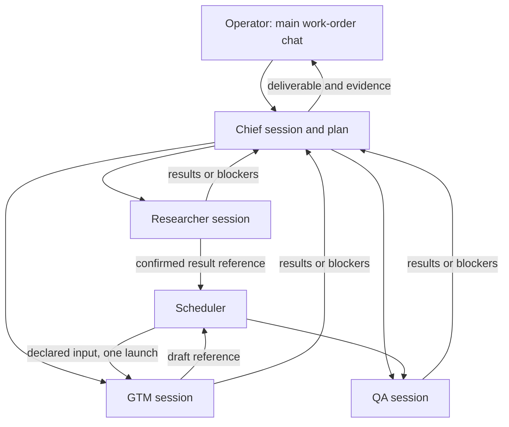

# Coordinator-led work-order execution

Status: approved design with a partial source implementation, 2026-10-04. This
refines [WORK_ORDER_SESSIONS_V2.md](WORK_ORDER_SESSIONS_V2.md). The session
ledger, enqueue API, child assignments, scoped Gateway tools, Chief decision
batching, and Task screen are implemented behind a database-owner-only team
mode. A runner-side Codex turn adapter has fake-provider PostgreSQL coverage.
No live isolated team worker or installed team-mode cutover has passed the
release gates, so this document does not describe installed behavior.

## Decision

A work order owns one continuing team session. The Chief of Staff owns the
objective and a short, editable plan. Each assignment has a separate agent
session and a bounded result contract. The operator may read every session.
The scheduler moves confirmed results along declared dependencies without
asking a model to relay them. An agent runs only when an admitted cause queues
an attempt for its own session. Reading a session or saving a passive peer
message is not such a cause.

The plan is a small dependency list, not a general automation language. A step
records owner profile, objective, required input references, expected result,
acceptance check, and dependencies. The Chief can revise it when evidence
changes. A child work order is needed only when that child owns a separate
deliverable or acceptance decision; a consultation remains a child session.

The final arrows to Chief mean durable, readable records. They trigger a Chief
model turn only under the rules below.

## The wake contract

| Saved cause | Durable action | Model turns queued |
| --- | --- | --- |
| Operator opens a session or timeline | Read saved records | Zero |
| Operator sends to an idle Chief or child | Save message and one continuation intent | One for that addressed agent |
| Operator sends while that agent is working | Save message; coalesce into its next continuation after current attempt settles | Zero immediately; at most one later |
| Agent publishes progress or a peer message | Save attributed update | Zero |
| Child produces a confirmed result | Satisfy its step; release each newly ready declared dependent once with specific result references | One per newly ready dependent; zero Chief turns |
| Child is blocked, a dependency fails, or QA rejects evidence | Save the cause in one pending Chief decision set | One Chief turn for the pending set, unless Chief is already working; then include it in the next continuation |
| All required branch results and checks are ready | Queue one Chief synthesis/review turn for that plan revision | One Chief turn |
| Operator resolves a wait or approves an action | Record decision, then resume only the affected agent | One addressed turn if work remains |
| Provider or tool attempt fails or becomes unknown | Save attempt and diagnostic; reconcile effects | Zero automatic retries; operator or agent can later continue from confirmed state |

A decision set has one identity per work order and plan revision. A transaction
adds causes to that set instead of creating one follow-up per child status.
The dispatcher claims it once, snapshots its causes, and marks them consumed
only when the addressed attempt is durably queued. Causes arriving during that
attempt remain pending for its next turn. Dependency release uses a uniqueness
key of plan revision, step, and confirmed input version so reconnects and
duplicate completion events cannot launch a child twice. A plan revision may
supersede a queued step only before it is claimed; active work needs an
explicit cancellation and a new revision. Scheduler work is deterministic and
does not itself call a provider.

For independent parallel branches, the Chief waits for the declared branch
barrier before final synthesis. A blocker that prevents useful remaining work
may bring the Chief forward; ordinary completions do not. This removes the
need for an arbitrary timer to collect sibling updates. If a second blocker
arrives after the Chief has already started, the next continuation sees it;
the design makes no promise that events separated by a running model turn
will cost only one turn.

No blanket sibling subscription exists. A child can read its own assignment,
its own messages, and named input results; it cannot silently inherit another
child's transcript. An unexpected question goes to the Chief as a blocker.
The Chief may authorize a focused peer consultation with one question and one
answer; that authorization starts only the addressed peer. The answer returns
to its requester and Chief as a result reference. If the requester is waiting
for that answer, the scheduler releases one addressed continuation as a
declared dependency; the Chief does not need a relay turn. Further exchange
requires a new decision. Message visibility, prompt inclusion, and model
activation are three independent permissions.

## State and context boundaries

| Record | State and invariant |
| --- | --- |
| Work order | Existing objective and outcome (`draft`, `ready`, `running`, `needs_review`, `done`, `failed`, `unknown`, and existing approval/blocked states). Evidence or explicit operator acceptance governs `done`. |
| Team/agent session | `open`, `working`, `waiting_for_agent`, `waiting_for_operator`, `closed`. A session remains usable when an attempt fails. |
| Plan step | `pending`, `ready`, `active`, `satisfied`, `blocked`, `canceled`. `satisfied` requires a confirmed result reference and its declared check. |
| Attempt | `queued`, `running`, `done`, `failed`, `unknown`. One active attempt per session; independent ready children may run concurrently under configured bounds. |
| Action | Gateway or runner receipt owns confirmed, failed, or unknown external effect. An unknown effect is never replayed from a new attempt. |

At each turn the context builder supplies the addressed agent's objective,
current plan step, confirmed messages in that session, explicitly addressed
messages, named dependency result references with bounded excerpts, relevant
evidence and approvals, approved memory, and unresolved uncertainty. It does
not supply unrelated sibling logs. It records included reference IDs and any
omission caused by the context bound. Truncated history remains queryable to
the operator. The agent must use a Gateway read to inspect more, subject to
the same project and tool permissions. A saved public update is an agent's
plan, finding, blocker, or next step; it is never represented as private
chain of thought.

The current `work_order_completion.settle` can set a work order to `failed` or
`unknown` when one run fails. The new owner must distinguish attempt outcome
from objective outcome at cutover. A failed attempt keeps the session open and
the objective active or waiting when viable work remains. A verified terminal
failure or explicit operator closure may still end the work order. An unknown
provider request is recorded once; a new continuation gets its uncertainty
and confirmed receipts, never an automatic resend. An unknown external effect
must be read back or resolved by the operator before repeating that effect.

## Spend and latency policy

The coordinator reviews expected *remaining work*, not only consumed tokens
or a hard ceiling. Before optional delegation or consultation, the scheduler
shows observed effort, mandatory unfinished steps, integration/revision/QA
reserve, and an estimate for the proposed extra turn. It prefers a direct
result transfer for declared dependencies; it prefers sequential work when
the next agent needs the preceding result. Parallel launches are justified by
independent work and expected elapsed-time benefit, with a cost to integrate
their outputs. Chief plan decisions are batched at the wake points above.

For metered providers, a dollar projection is allowed only when an actual
usage/cost owner or documented rate source covers the relevant attempts.
For the existing Codex account, `task_conversation_store` stores token counts
but leaves `cost_usd` null; its subscription charge is not a per-turn billed
receipt. Display observed turns, input/output tokens when available, elapsed
time, and an effort estimate. Display billed USD and USD-to-target as
**unknown**, never zero. An operator-entered hypothetical rate may produce a
separately labeled scenario, never an actual charge. Historical estimates
must show sample count and uncertainty; absent or unknown usage produces
`forecast unavailable`, not a fabricated number. No forecast alone may mark
an outcome complete or authorize an outbound action.

The planning checkpoint compares the estimated remaining effort plus work
already spent with the target. If it exceeds the target, the Chief simplifies
or sequences optional work before it launches more agents. A separate hard
ceiling remains a safety bound. The existing `onefoundry_budget` reservations
are workflow-specific and cannot silently serve as work-order-session
accounting. The implementation should reuse their atomic reservation and
unknown-settlement ideas through the session owner rather than adding a
second competing total. The dashboard should attribute model turns and usage
to Chief planning, specialist production, consultations, revision, and QA so
coordination overhead is visible.

## Operator screen

The work-order page keeps the objective and current status above one anchored
composer. The main pane shows the Chief conversation with public plan,
findings, result, and next step. A compact Team list shows each child agent,
assignment, state, and last saved update; selecting one opens its own
conversation and observed actions without leaving the work order. The child
view has a clear return to Chief. A Work log gives a chronological cross-team
view with agent attribution and filters for messages, actions, blockers, and
artifacts. It is a read model, so opening or filtering it has zero model cost.

The header shows observed effort and forecast confidence; when Codex billed
cost is unavailable it says "USD cost unknown". A blocker panel shows the
single concrete operator decision or approval needed. **Continue work** is
available after a stopped attempt and names the agent it will resume. The UI
separates "message saved", "agent working", "action confirmed", "needs your
decision", and "deliverable accepted". Technical IDs, prompt selection,
token counts, and raw receipts stay in expandable Details. On mobile the Team
list is a compact switcher above the same anchored composer; the work log is
its own scroll region rather than a giant transcript.

## Current owner paths and cutover

| Current owner | Change required |
| --- | --- |
| `task_conversation_store.py` / `task_conversation_api.py` | Keep historical chats readable. Move new Send to durable enqueue and worker execution; stop interpreting final prose/JSON as a team action once Gateway-backed actions pass parity. |
| `chief_followup.py` / `coordination_launcher.py` | Replace one-model-turn-per-child-status with the decision set and dispatcher. Disable the old trigger for a migrated work order in the same transaction as cutover; do not run both. |
| `coordination_autostart.py` | Preserve bounded launch and unknown-outcome safeguards, but consume ready session steps rather than starting disconnected one-shot text runs. |
| `work_order_completion.py` | Keep evidence checks; settle individual attempts separately from the objective and only close it on verified acceptance or terminal decision. |
| `job_dossier.py` | Read the current team plan, child results, receipts, and unresolved uncertainty from canonical owners; do not infer work from model prose. |
| `onefoundry_budget.py` / `onefoundry_metrics.py` | Provide a single attribution/usage read model for session attempts, keeping unknown cost distinct from zero. |
| `runner/codex_app_server.py` / Execution Gateway | Bind one OneFoundry session to its saved provider thread and exact attempt; prove scoped Gateway tool admission, restart/resume, isolation, and receipt readback before live autonomous Chief work. |

Store only the minimum new normalized records: agent sessions, messages,
attempts, plan steps/dependencies, and one pending decision set. Existing
work-order, run, approval, artifact, and event owners remain canonical for
their effects. Every new record carries project and actor binding. Only the
Gateway and runner append activity events. The session worker is a consumer,
not a new event authority. API writes use client IDs and expected sequence;
the HTTP response acknowledges saved input promptly, while worker progress
arrives through the timeline. Both the old and new read paths are compared
before one work order is switched to new writes. Historical turns are
imported as history, never as proof of delegation. No automatic replay occurs
during migration. Rollback returns writes to the prior path only after all
newly queued work is reconciled; it cannot erase confirmed receipts.

## Video order example and proof

For the existing demo-video order, the Chief first records an achievable
deliverable and the need for product access and a production owner. A
Researcher step can collect supported product facts. GTM's script step is
declared dependent on that result, so the scheduler passes its saved summary
and references to GTM once. A production step cannot be claimed as done from
a script or proposal: it needs a playable file path, hash, and owner receipt.
QA receives the draft only after it exists and records playback/review checks.
If capture access is missing, the Chief gets one blocker and asks the operator
for the exact missing permission or owner. The operator's reply resumes the
same work order and addressed child. Final synthesis does not close the order
until its deliverable evidence and acceptance requirements are satisfied.

The first acceptance slice must prove with counters and saved records:

1. Viewing all sibling sessions and saving a progress or peer note cause zero
   provider turns; a completed child releases only its declared dependents.
2. Two child outcomes saved before the dispatcher claim produce one Chief
   decision attempt with both causes; duplicate events or reloads produce no
   extra launches.
3. A child prompt includes its named dependency output and excludes an
   unrelated sibling transcript, including after long-history truncation.
4. A failed or unknown provider/tool attempt leaves the same session usable;
   no external effect is replayed without readback. The old video order's
   rejected assignment proposal remains rejected history.
5. Unknown Codex USD cost displays as unknown; known token usage is attributed
   once; a forecast does not hide missing usage. Project isolation and tool
   denial hold for every child and consultation.
6. Desktop and 390 px browser views show the main chat, child sessions,
   public plan/findings/actions, blocked next step, and evidence without raw
   private reasoning. A real restricted Codex resume and admitted Gateway
   tool call are required before claiming live team execution.

Implement in order: ledger/read compatibility, enqueue/continuation and
recovery, restricted Codex bridge, child/dependency dispatcher with cost
read model, then unified UI and installed acceptance. Each slice has a
regression test and local commit; the installed workflow is not called ready
until the real runner, PostgreSQL, API, and browser gates pass.
